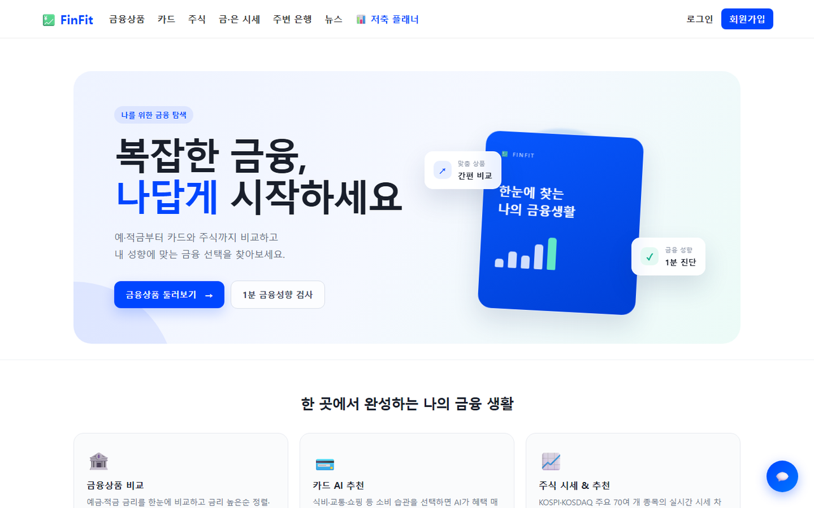
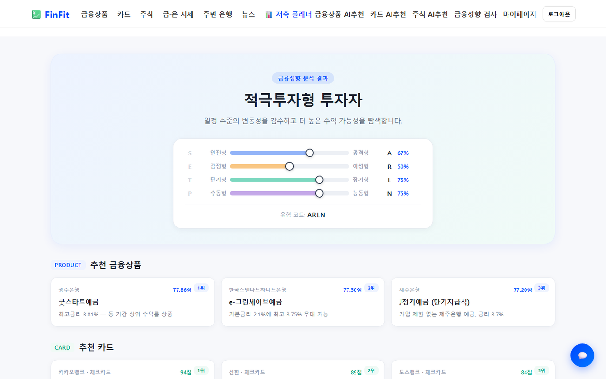
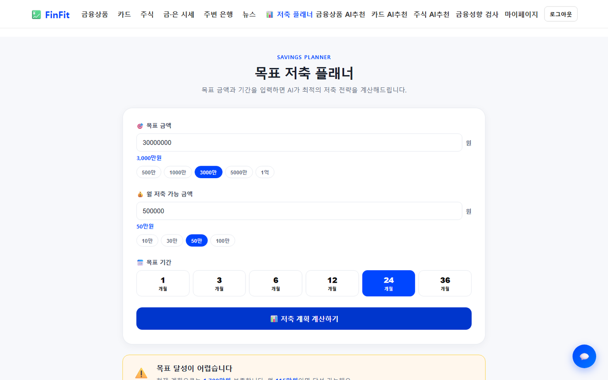
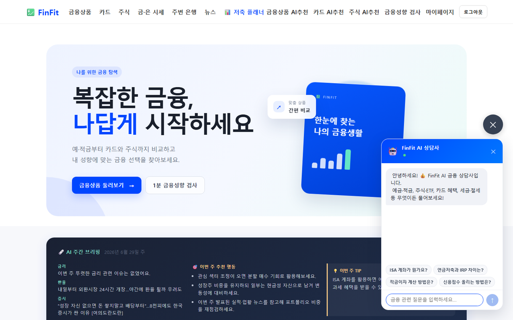

# FinFit — 제가 맡은 부분 (이윤우)

2명이 만든 FinFit에서 제가 맡은 백엔드와, 프로젝트가 끝난 뒤 따로 한 배포를 항목별로 정리한 문서입니다. 실행 방법과 배포 절차는 [README](README.md)에 있습니다.

## 1. Project Overview

- 프로젝트명: FinFit — 금융성향 검사 결과로 예·적금, 주식, 카드를 추천하는 서비스
- 개발 기간: 2026.05.18 ~ 2026.06.26 (기획 포함, SSAFY 15기 1학기 관통 프로젝트). 배포는 프로젝트가 끝나고 약 석 달 뒤인 2026.09.12에 따로 했습니다
- 팀 구성: 2명 (백엔드 1 · 프론트엔드 1)
- 담당 역할: 팀장, 백엔드 전체. 기획·일정 관리·API 명세 작성·발표 준비를 이끌었고, Django REST Framework API를 설계하고 구현했습니다
- GitHub: https://github.com/luster-woo/finance_pjt
- 기술 스택: Python · Django · Django REST Framework · SimpleJWT · APScheduler · SQLite(개발) · PostgreSQL 16(배포) · Docker Compose · nginx · gunicorn · AWS EC2
- 외부 API: 금융감독원 FinLife · SSAFY GMS · Gemini 1.5 Flash · yfinance · RSS · Kakao Local/Mobility

## 2. My Contribution

| 홈 화면 | 금융성향 검사 결과와 추천 |
| :---: | :---: |
| <a href="./screenshots/00_home_guest.png"></a> | <a href="./screenshots/13_test_result.png"></a> |
| **목표 저축 플래너** | **AI 금융 상담** |
| <a href="./screenshots/17_planner.png"></a> | <a href="./screenshots/21_ai_chatbot_open.png"></a> |

<sub>화면을 누르면 전체 캡처가 열립니다.</sub>


직접 담당한 기능과 개발 범위

- 인증: JWT 로그인·로그아웃(Refresh Token 블랙리스트)
- 금융상품: FinLife 연동과 관리자 전용 수집 API, 검색·정렬·필터·비교 API, 관심 상품
- 금융성향 검사: 10문항 검사, 4자리 성향 코드 산출, 역방향 문항 보정
- 추천: 성향 기반 예·적금·주식·카드 추천, 목돈·기간 입력형 추천, 추천 근거 생성, AI 실패 시 대체 경로
- 주식·뉴스: 시세 수집, RSS 뉴스 수집·정제, AI 주간 브리핑 자동 생성
- 그 밖에: AI 금융 상담, 리뷰·커뮤니티, 주변 은행 검색 API
- 배포(2026.09): 개발/운영 환경 분리, Docker Compose 구성, nginx 설정, EC2 배포와 검증, 배포 문서

팀에서 구현한 부분

- 프론트엔드 전체(Vue 3 · Pinia · Vite)는 팀원이 만들었습니다. 저는 프론트 파일 일부(인증 처리 등)만 고쳤습니다
- 카드·예적금 추천은 둘이 함께 기획했고, 기능명세서·와이어프레임·화면명세서도 함께 썼습니다
- 배포는 팀 과제가 아니었습니다. 팀원에게 미리 알리고 제가 직접 맡아 진행했습니다

## 3. Architecture

전체 시스템 구조

```text
                    Vue 3
                      │ REST · JWT
                      ↓
                Django / DRF
                      │
       ┌──────────────┼──────────────┐
       ↓              ↓              ↓
   SQLite / PG     상품 수집       주식 · 뉴스 수집
                  (관리자 API)      (스케줄러)
                      ↓              ↓
                 FinLife API    yfinance · RSS

   추천 · 상담 · 번역 · 브리핑 → GMS → Gemini → 규칙 기반 점수(추천만)
```

담당 영역의 구조 (배포 구성)

```text
브라우저 :80
   │
 nginx ── /         → Vue dist (SPA)
       ── /api/*    → gunicorn (접두사 제거)
       ── /admin/   → gunicorn
       ── /static/  → collectstatic 결과
            │
          web (Django + gunicorn 워커 3) ── db (PostgreSQL 16)
          sched (APScheduler)            ──┘
```

서버 간 통신 방식

- 브라우저 ↔ Django: REST, JWT(Access 2시간 · Refresh 7일)
- Django ↔ 외부 API: HTTP 요청. AI 호출은 20초 타임아웃을 두고, 요청 예외·빈 응답·JSON 파싱 실패를 모두 실패로 봅니다
- 배포 구성에서는 nginx가 프론트와 API를 한 주소로 묶어, 밖으로 열린 포트는 80 하나입니다. DB와 gunicorn은 Docker 네트워크 안에만 있습니다

데이터 흐름

```text
[수집] 관리자 → FinLife API → DB 저장 (update_or_create)
[조회] 사용자 → Django ORM → 검색 · 정렬 · 필터 · 비교
[주기 작업] 스케줄러 → 뉴스(3시간마다) · 주식 시세(평일 17시) · 금은 시세(8시) · 주간 브리핑(월요일 9시)
```

상품 수집은 스케줄러에 없습니다. 관리자가 수집 API를 호출해야 갱신됩니다.

데이터베이스 구성

- 개발은 SQLite, 배포는 PostgreSQL 16 컨테이너(볼륨 분리)입니다. ORM을 쓰고 있어서 전환은 설정 변경으로 끝났습니다
- 사용자(User)를 중심으로 성향 검사 결과와 AI 추천 결과, 관심·가입·최근 본 상품, 리뷰, 커뮤니티 글이 연결됩니다
- 금융상품과 기간별 금리 옵션, 주식과 일별 시세, 카드와 혜택, 뉴스와 주간 브리핑이 각각 짝을 이룹니다
- 전체 모델 표와 ERD는 [설계서](docs/설계서.md)에 있습니다

## 4. Key Implementations

### 4-1. 상품 수집과 조회 분리

- 구현 목적: 상품 목록을 열 때마다 FinLife API를 불러 목록 하나에 평균 4.5초가 걸렸습니다. API가 필터와 정렬도 지원하지 않았습니다
- 적용 기술: Django ORM, DRF 권한(`IsAdminUser`), `update_or_create`
- 구현 과정: 관리자만 호출할 수 있는 수집 API가 상품을 DB에 저장하고, 사용자 요청은 DB만 읽게 나눴습니다
- 기술적 고려사항: 외부 API 속도는 바꿀 수 없어서 부르는 위치를 옮겼습니다. 캐시가 아니라 수집 분리입니다. 대신 상품 정보는 관리자가 다시 수집해야 바뀝니다

### 4-2. 추천 기준을 서비스가 정하기

- 구현 목적: "적합한 상품을 추천해 줘"라고만 보내면 같은 입력에도 순위와 근거가 매번 달랐습니다
- 적용 기술: LLM 프롬프트, 규칙 기반 점수
- 구현 과정: 목돈·기간 입력형 추천에 채점 기준을 직접 정해 프롬프트에 넣었습니다(금리 경쟁력 40 · 수익 절대액 30 · 상품 유형 적합성 15 · 은행 신뢰도와 인근 여부 15)
- 기술적 고려사항: 처음에는 금리 비중을 가장 크게 뒀는데, 금리는 높지만 납입 한도가 낮거나 기간이 짧아 실제 이자는 적은 상품이 위로 올라왔습니다. 금리는 비율이고 이자는 금액이라 만기 예상 이자를 별도 항목으로 뺐습니다

### 4-3. AI가 답을 안 줘도 추천은 나오게

- 구현 목적: 추천, 상담, 뉴스 번역, 주간 브리핑이 전부 외부 AI API 하나(GMS)에 걸려 있었습니다
- 적용 기술: GMS(OpenAI 호환) · Gemini · 규칙 기반 점수, 타임아웃과 응답 전처리
- 구현 과정: 추천에는 GMS → Gemini → 규칙 기반 점수로 넘어가는 경로를 미리 만들었습니다. 응답이 코드블록으로 감싸져 오면 벗겨 내고 파싱하고, 후보에 없는 상품 ID는 버립니다
- 기술적 고려사항: 이 경로는 처음에 추천에만 있었습니다. 나머지 세 기능에는 장애를 겪은 뒤에 붙였습니다(5번 문제 1)

### 4-4. 금융성향 검사의 역방향 문항

- 구현 목적: 모든 문항을 같은 방향으로 물으면 읽지 않고 한쪽으로만 답할 수 있습니다
- 적용 기술: Django, 단위 테스트
- 구현 과정: Q2·Q6·Q9는 반대로 묻고 채점할 때 뒤집습니다. 검사 결과인 4자리 코드는 추천, 유사 사용자 통계, 저축 플래너의 상품 필터가 같이 씁니다
- 기술적 고려사항: 모두 최고점, 모두 최저점, 역방향 문항만 반대로 고른 응답을 넣어 보니 보정을 빼면 성향이 거꾸로 나왔습니다

### 4-5. 배포 — 개발과 운영에서 달라야 하는 것

- 구현 목적: 프로젝트 기간에 하지 못한 배포를 끝내는 것
- 적용 기술: Docker Compose(nginx · web · sched · db), gunicorn, PostgreSQL 16, AWS EC2
- 구현 과정: DB, 정적 파일, 스케줄러, 비밀값, CORS, 프론트 API 주소 여섯 가지를 개발과 운영에서 다르게 가져가도록 정리했습니다. 서버로 가기 전에 로컬에서 운영 구성을 그대로 한 번 띄웠습니다
- 기술적 고려사항: 웹 서버는 여러 개로 늘려도 주기 작업은 하나만 돌아야 해서 스케줄러를 전용 컨테이너로 뺐습니다(5번 문제 3)

## 5. Technical Challenges

### 문제 1. 발표 이틀 전에 AI 기능 세 개가 멈췄습니다

- Situation: 주식 화면에서 뉴스 번역이 되지 않았습니다. 번역, AI 상담, 주간 브리핑이 같이 멈췄습니다
- Cause: 팀이 같이 쓰는 GMS 사용량 한도가 다 떨어졌습니다. 성능을 높이려고 큰 모델을 시험하다 한도를 다 썼습니다. 모델을 바꾸는 과정에서 환경변수를 잘못 넣어 기존 호출까지 멈춘 실수도 있었고, 바로 고쳤습니다
- Solution: 가벼운 모델로 바꾸고 사용량을 더 받아 다시 연결했습니다. 그 뒤 세 기능에도 다른 모델로 넘어가는 경로를 붙였습니다
- Result: 추천은 미리 만들어 둔 경로 덕분에 멈추지 않았고, 그날은 규칙 기반 점수로 결과를 냈습니다. 세 기능은 발표 전에 복구돼 발표 때 정상 동작했습니다. 복구에 걸린 시간은 기록하지 않았습니다

### 문제 2. 주식 뉴스 제목이 어느 날 전부 비었습니다

- Situation: 종목 상세의 관련 뉴스 제목이 모두 빈 값으로 표시됐습니다
- Cause: yfinance의 응답 구조가 바뀌어 제목이 `content` 안으로 옮겨졌습니다. yfinance는 비공식 라이브러리입니다
- Solution: `content`가 있으면 거기서 꺼내고, 없으면 기존 위치에서 읽게 했습니다. 외부 데이터의 날짜가 시간대 정보 없이 들어와 저장되지 않던 문제는 `make_aware()`로 변환해 저장하도록 통일했습니다
- Result: 제목이 다시 표시됐습니다

### 문제 3. 배포하면 스케줄러가 오류 없이 꺼질 구조였습니다

- Situation: 개발 서버가 코드를 다시 읽을 때마다 스케줄러가 두 번 등록돼, `RUN_MAIN` 환경변수로 실행 프로세스를 구분해 막고 있었습니다
- Cause: `RUN_MAIN`은 runserver가 만드는 값이라 gunicorn에는 없습니다. 그대로 올리면 스케줄러가 오류 없이 꺼지고, web 컨테이너에서 켜면 워커 3개가 같은 수집을 세 번 돌립니다
- Solution: 스케줄러 전용 컨테이너를 하나 두고 관리 명령으로 실행했습니다. 초기화(migrate·collectstatic)는 web 컨테이너만 하게 했습니다
- Result: 배포 전에 고쳐서 서버에서는 이 문제를 겪지 않았습니다

### 문제 4. 서버에서 막힌 네 군데

- Situation: 인스턴스 시작 거부, 빌드 중 디스크 부족, 서버 안에서 `/api/*`만 400, 컨테이너는 다 떴는데 밖에서 접속되지 않음
- Cause: 순서대로 AMI 선택 실수, EBS 기본 크기 8GiB에 스왑 파일 4GB, 테스트할 때의 Host 헤더, 보안 그룹 인바운드 누락이었습니다. 전부 인프라 설정 문제였습니다
- Solution: 접속 문제는 서버 안 응답, 포트 대기, OS 방화벽, 서버가 자기 공인 IP를 부르는 순서로 안쪽부터 확인해 범위를 좁혔습니다
- Result: 네 건 모두 해결했고, 로컬에서 먼저 띄워 본 덕분에 애플리케이션 문제는 없었습니다. 자세한 과정은 [배포일지](deploy/배포일지.md)에 있습니다

## 6. Performance & Results

개선 전후 비교와 API 응답 시간

| 항목 | 조건 | 값 |
|---|---|---|
| 상품 목록 응답 | 로컬, 브라우저 Network 탭과 Postman, 전후 각 20회 평균 | 평균 4.5초 → 평균 80ms |
| 배포 후 `/api/products/` | 외부에서 curl | 0.40초 |
| 배포 후 `/` · `/api/news/` | 외부에서 curl | 0.38초 · 0.42초 |

로컬 값과 배포 값은 잰 위치가 달라 서로 비교하지 않습니다.

테스트 결과

- 성향 검사 로직 단위 테스트 18개(역방향 보정 4 · 4축 계산 7 · 추천 점수 7). 발표가 끝난 뒤 붙였습니다
- 추천 일관성: 채점 기준을 넣은 뒤 목돈·기간 조합 50가지를 두 번씩 돌려 추천 상품, 순위, 근거 문장이 같게 나오는지 확인했습니다

배포 실측

- 컨테이너 4개 메모리 합계 469MB (web 305 · sched 102 · db 58 · nginx 4)
- 배포 당일 약 2시간(로컬에서 먼저 띄워 본 시간 포함)

재지 않은 것

- GMS 장애 복구에 걸린 시간
- 사용자 수와 트래픽. 확인을 마친 뒤 인스턴스를 종료해 지금 접속할 주소는 없습니다

## 7. Retrospective

개발하면서 배운 점

- 외부 서비스가 늘 정상이라는 가정을 버렸습니다. 느린 의존성은 사용자 요청 경로에서 떼어 내고, 멈출 수 있는 의존성에는 넘어갈 경로를 미리 붙입니다
- AI에 판단을 다 맡기지 않고 기준을 먼저 정해 넣었더니 결과가 일관됐고 근거도 같이 뽑을 수 있었습니다

아쉬웠던 점

- 프로젝트 기간 안에 배포하지 못했습니다. 로컬에서 돌아가면 끝이라고 보고 일정에 넣지 않았습니다. 기술 문제가 아니라 완성 기준을 좁게 잡은 판단의 문제였습니다
- 로그아웃할 때 Refresh Token을 블랙리스트에 넣는 코드를 만들었지만, 프론트가 refresh 토큰을 보내지 않아 실제 로그아웃 경로에서는 동작하지 않습니다
- 주식은 종목 조회, 관심 종목, 시세 차트까지 만들었고 모의 매수·매도는 기간 안에 붙이지 못했습니다
- 배포에 HTTPS를 붙이지 않았습니다. 도메인 없이 IP로만 띄웠습니다

현재 다시 개발한다면 개선할 부분

- 처음부터 배포를 일정에 넣겠습니다. 그랬다면 `RUN_MAIN`처럼 개발 서버에만 있는 전제를 코드에 넣지 않았을 겁니다. 환경 차이는 배포할 때 발견하는 것보다 처음부터 가정하지 않는 편이 쌉니다
- Gemini인지 판별하는 코드가 세 곳에 복사돼 있고 주소 문자열에 기댑니다. 공급자를 설정값으로 두고 호출 함수를 하나로 모으겠습니다
- EBS는 처음부터 20GiB로 잡고, 보안 그룹 인바운드는 인스턴스를 만든 직후에 확인하겠습니다
