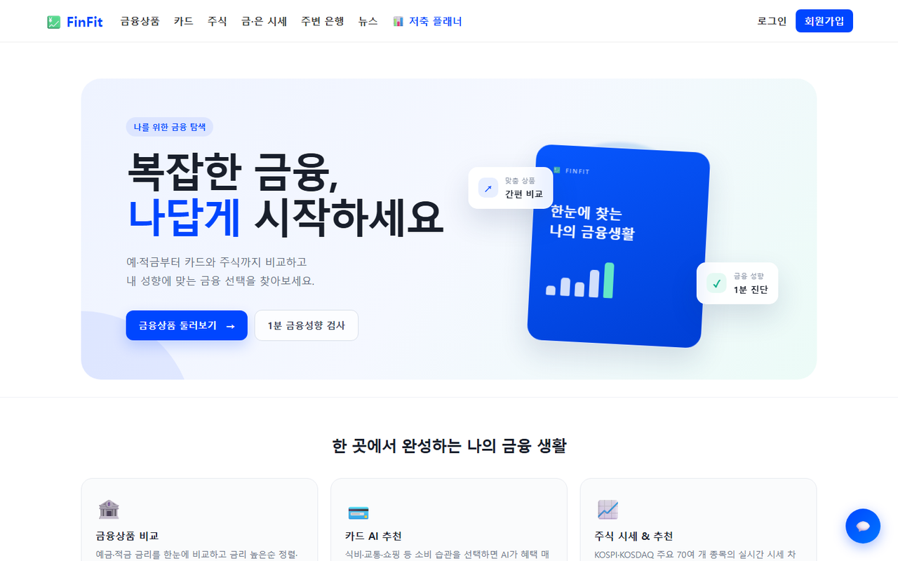
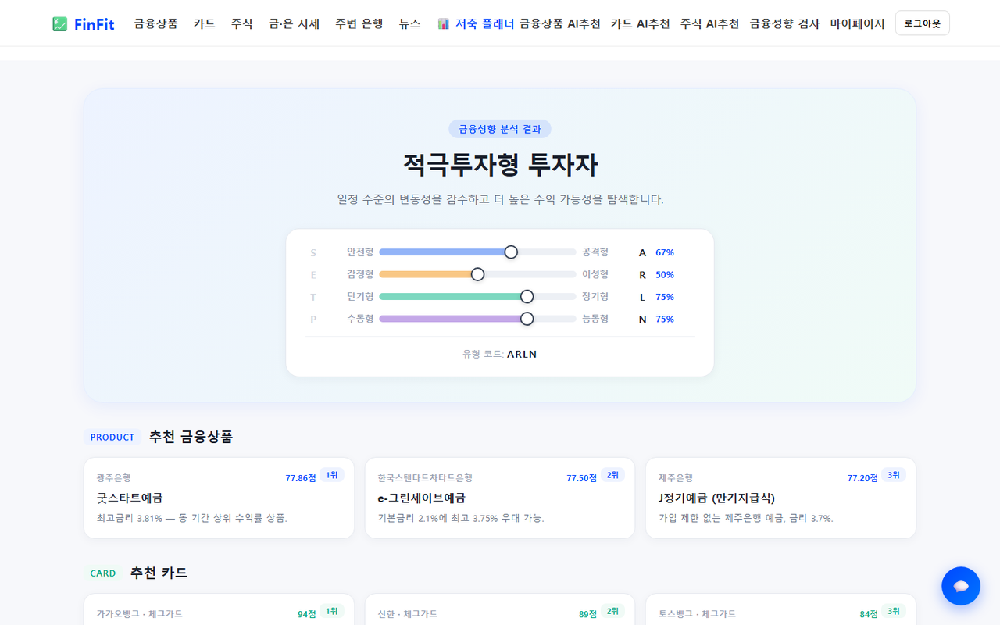
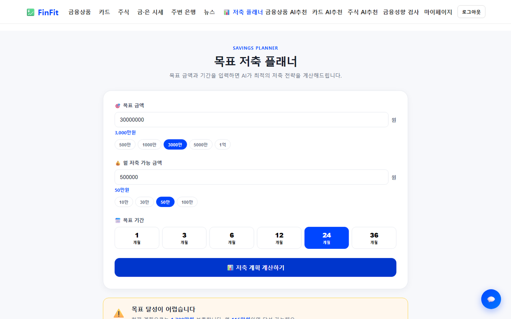
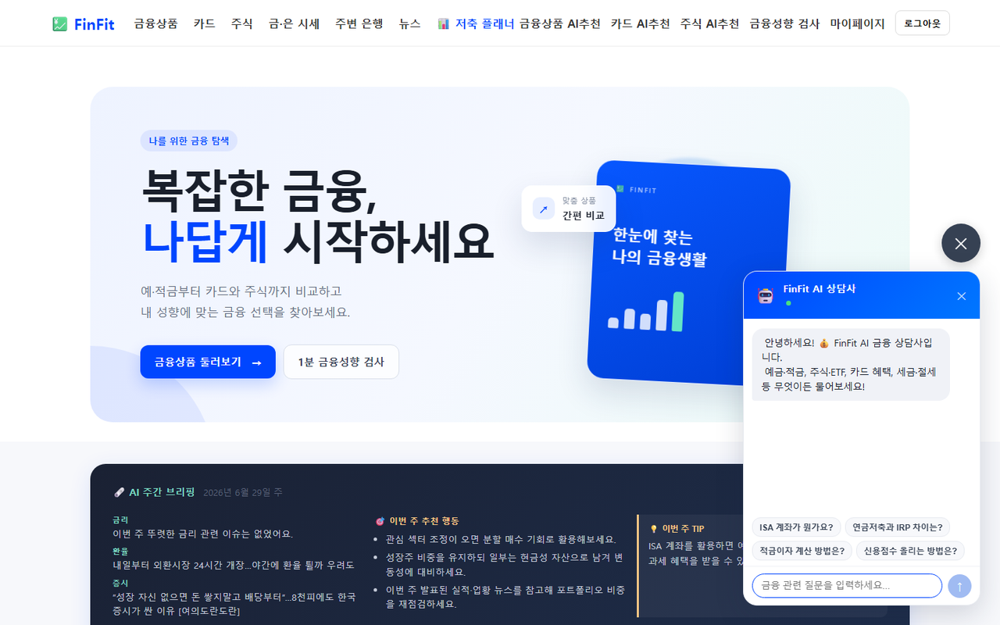

# FinFit

금융성향 검사를 먼저 하고, 그 결과로 예·적금, 주식, 카드를 추천해 주는 서비스입니다. 상품이 수백 개라 무엇부터 봐야 할지 모르는 사회초년생을 생각하고 만들었습니다.

| 홈 화면 | 금융성향 검사 결과와 추천 |
| :---: | :---: |
| <a href="./screenshots/00_home_guest.png"></a> | <a href="./screenshots/13_test_result.png"></a> |
| **목표 저축 플래너** | **AI 금융 상담** |
| <a href="./screenshots/17_planner.png"></a> | <a href="./screenshots/21_ai_chatbot_open.png"></a> |

<sub>화면을 누르면 전체 캡처가 열립니다.</sub>

제가 맡은 백엔드와 배포를 구현 과정까지 풀어 쓴 글은 [PORTFOLIO.md](PORTFOLIO.md)에 있습니다.

## 1. Project Overview

- 프로젝트명: FinFit — 금융성향 기반 금융상품 추천 서비스
- 개발 기간: 2026.05.18 ~ 2026.06.26 (기획 포함, SSAFY 15기 1학기 관통 프로젝트). 배포는 약 석 달 뒤인 2026.09.12에 따로 했습니다
- 팀 구성: 2명 (백엔드 1 · 프론트엔드 1)
- 담당 역할: 팀장, 백엔드 전체
- GitHub: https://github.com/luster-woo/finance_pjt
- 기술 스택: Python · Django · Django REST Framework · SimpleJWT · APScheduler · SQLite(개발) · PostgreSQL 16(배포) · Docker Compose · nginx · gunicorn · AWS EC2
- 외부 API: 금융감독원 FinLife · SSAFY GMS · Gemini 1.5 Flash · yfinance · RSS · Kakao Local/Mobility

## 2. My Contribution

- 인증(JWT), 금융상품 수집·검색·비교 API, 관심 상품
- 금융성향 검사와 4자리 성향 코드, 성향 기반 추천과 추천 근거 생성
- 주식 시세·뉴스 수집, AI 주간 브리핑, AI 금융 상담, 리뷰·커뮤니티, 주변 은행 검색
- 배포(2026.09): 개발/운영 환경 분리, Docker Compose 구성, EC2 배포와 검증, 배포 문서

프론트엔드 전체(Vue 3)는 팀원이 만들었고, 저는 프론트 파일 일부만 고쳤습니다. 배포는 팀 과제가 아니어서 팀원에게 미리 알리고 직접 맡아 진행했습니다.

## 3. Architecture

```text
                    Vue 3
                      │ REST · JWT
                      ↓
                Django / DRF
                      │
       ┌──────────────┼──────────────┐
       ↓              ↓              ↓
   SQLite / PG     상품 수집       주식 · 뉴스 수집
                  (관리자 API)      (스케줄러)
                      ↓              ↓
                 FinLife API    yfinance · RSS

   추천 · 상담 · 번역 · 브리핑 → GMS → Gemini → 규칙 기반 점수(추천만)
```

- 서버 간 통신: 브라우저와 Django는 REST·JWT. 외부 AI 호출은 20초 타임아웃을 두고 요청 예외·빈 응답·JSON 파싱 실패를 모두 실패로 봅니다
- 데이터 흐름: 관리자가 수집 API를 호출하면 FinLife 상품이 DB에 저장되고, 사용자 조회는 DB만 읽습니다. 뉴스와 시세는 스케줄러가 주기적으로 모읍니다
- 데이터베이스: 개발은 SQLite, 배포는 PostgreSQL 16. 모델 표와 ERD는 [설계서](./docs/설계서.md)에 있습니다
- 배포 구성: nginx · web(gunicorn 워커 3) · sched(스케줄러 전용) · db 컨테이너 4개. 밖으로 열린 포트는 80 하나입니다

## 4. Key Implementations

| 기능 | 구현 목적 | 적용 기술 | 기술적 고려사항 |
|---|---|---|---|
| 상품 수집과 조회 분리 | 목록을 열 때마다 외부 API를 불러 느린 응답 | Django ORM · `IsAdminUser` | 캐시가 아니라 수집 분리. 상품은 관리자가 다시 수집해야 갱신 |
| 추천 기준 정의 | 같은 입력에도 순위와 근거가 달라지는 문제 | LLM 프롬프트 · 규칙 기반 점수 | 금리(비율)와 만기 예상 이자(금액)를 별도 항목으로 분리 |
| AI 대체 경로 | 외부 AI가 멈춰도 추천은 나오게 | GMS → Gemini → 규칙 기반 점수 | 처음에는 추천에만 있었고, 나머지 세 기능에는 장애 뒤에 추가 |
| 역방향 문항 보정 | 한쪽으로만 답하는 응답 편향 | 단위 테스트 | 보정을 빼면 성향이 거꾸로 나오는 것을 극단 응답으로 확인 |
| 스케줄러 분리(배포) | 웹 서버는 여러 개, 주기 작업은 하나 | Docker Compose · gunicorn | `RUN_MAIN`은 runserver에만 있는 값이라 전용 컨테이너로 분리 |

## 5. Technical Challenges

| Situation | Cause | Solution | Result |
|---|---|---|---|
| 발표 이틀 전 번역·AI 상담·주간 브리핑이 멈춤 | 팀이 같이 쓰는 GMS 사용량 한도 초과 | 가벼운 모델로 바꾸고 사용량을 더 받아 복구, 그 뒤 대체 경로 추가 | 추천은 멈추지 않았고 세 기능은 발표 전에 복구 |
| 주식 뉴스 제목이 전부 빈 값 | yfinance 응답 구조 변경 | 새 위치에서 먼저 읽고 없으면 기존 위치 | 제목이 다시 표시됨 |
| 배포하면 스케줄러가 오류 없이 꺼질 구조 | 중복 실행 방지에 쓰던 값이 gunicorn에는 없음 | 스케줄러 전용 컨테이너 | 배포 전에 고쳐 서버에서는 겪지 않음 |
| 컨테이너는 떴는데 밖에서 접속되지 않음 | 보안 그룹 인바운드 누락 | 서버 안쪽부터 바깥으로 순서대로 확인 | 서버에서 막힌 네 건 모두 해결 ([배포일지](./deploy/배포일지.md)) |

## 6. Performance & Results

| 항목 | 조건 | 값 |
|---|---|---|
| 상품 목록 응답 | 로컬, 브라우저 Network 탭과 Postman, 전후 각 20회 평균 | 평균 4.5초 → 평균 80ms |
| 배포 후 `/api/products/` | 외부에서 curl | 0.40초 |
| 컨테이너 4개 메모리 | 배포 서버 실측 | 합계 469MB |

- 로컬 값과 배포 값은 잰 위치가 달라 서로 비교하지 않습니다
- 성향 검사 로직 단위 테스트 18개 (발표 뒤에 추가)
- 추천 일관성: 목돈·기간 조합 50가지를 두 번씩 돌려 추천 상품, 순위, 근거 문장이 같은지 확인
- GMS 장애 복구에 걸린 시간은 기록하지 않았습니다

## 7. Retrospective

- 배운 점: 외부 서비스가 늘 정상이라는 가정을 버렸습니다. 느린 의존성은 사용자 요청 경로에서 떼어 내고, 멈출 수 있는 의존성에는 넘어갈 경로를 미리 붙입니다
- 아쉬웠던 점: 프로젝트 기간 안에 배포하지 못했습니다. 로그아웃 블랙리스트는 프론트가 refresh 토큰을 보내지 않아 실제 경로에서는 동작하지 않습니다. 주식 모의 매수·매도는 붙이지 못했습니다
- 다시 한다면: 처음부터 배포를 일정에 넣고, Gemini 판별 코드가 세 곳에 복사된 것을 호출 함수 하나로 모으겠습니다

## 실행 방법

```bash
git clone https://github.com/luster-woo/finance_pjt.git
cd finance_pjt

# 백엔드
pip install -r requirements.txt
cd BE
python manage.py migrate
python manage.py runserver

# 프론트 (새 터미널)
cd FE
npm install
npm run dev
```

루트의 `.env`에 아래 값을 넣습니다. `.env.example`을 참고하면 됩니다.

```env
SECRET_KEY=
FINLIFE_API_KEY=
GMS_API_KEY=
GMS_API_URL=
GEMINI_API_KEY=
KAKAO_REST_API_KEY=
VITE_KAKAO_MAP_KEY=
```

서버를 띄운 뒤 관리자 계정으로 아래 두 API를 호출하면 상품 데이터가 들어옵니다.

```text
/products/save-products/
/products/save-saving-products/
```

## 배포

프로젝트가 끝나고 석 달 뒤에 운영 구성을 따로 만들어 AWS EC2(t3.small, Ubuntu 24.04)에 올렸습니다.

```bash
cp .env.prod.example .env.prod   # SECRET_KEY, ALLOWED_HOSTS, POSTGRES_PASSWORD
docker compose -f docker-compose.prod.yml --env-file .env.prod up -d --build
```

도메인이 없어 HTTPS는 붙이지 않았습니다. 확인을 마친 뒤 인스턴스는 종료해서 지금 접속할 주소는 없습니다. 절차는 [배포 문서](./deploy/README.md)에, 서버에서 막혔던 네 군데와 원인은 [배포일지](./deploy/배포일지.md)에 적었습니다.

## 문서

| 문서 | 내용 |
|---|---|
| [설계서](./docs/설계서.md) | 기획 의도, 기능 설계, 흐름도, DB 모델링 |
| [API 명세](./docs/api.md) | 전체 엔드포인트와 요청·응답 예시 |
| [기술 스택](./docs/tech-stack.md) | 기술을 고른 이유 |
| [트러블슈팅](./docs/trouble-shooting.md) | 개발하면서 막힌 문제와 해결 과정 |
| [배포](./deploy/README.md) · [배포일지](./deploy/배포일지.md) | 운영 구성, EC2 배포 절차, 막힌 지점 |

## 팀

| 이름 | 역할 |
|---|---|
| 이윤우 | 팀장, 백엔드 전체 (Django API 설계와 구현, 배포) |
| 이진웅 | 프론트엔드 전체 (Vue 3) |
